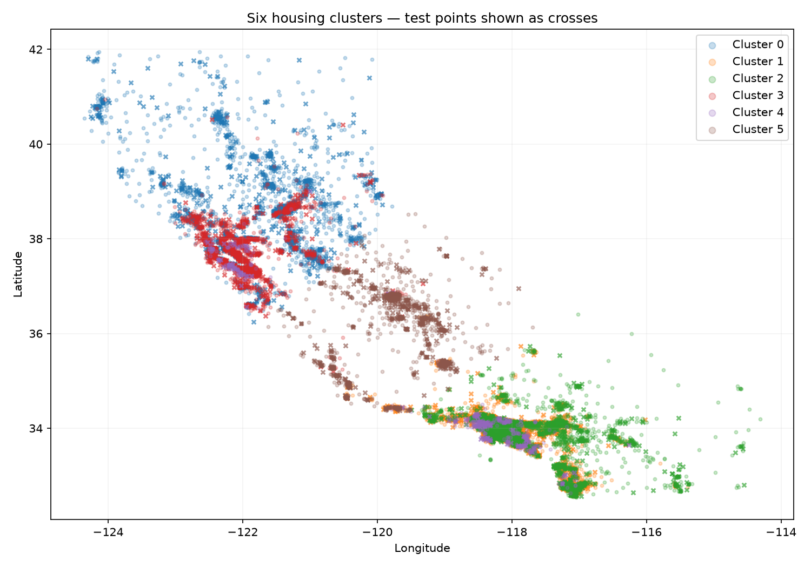
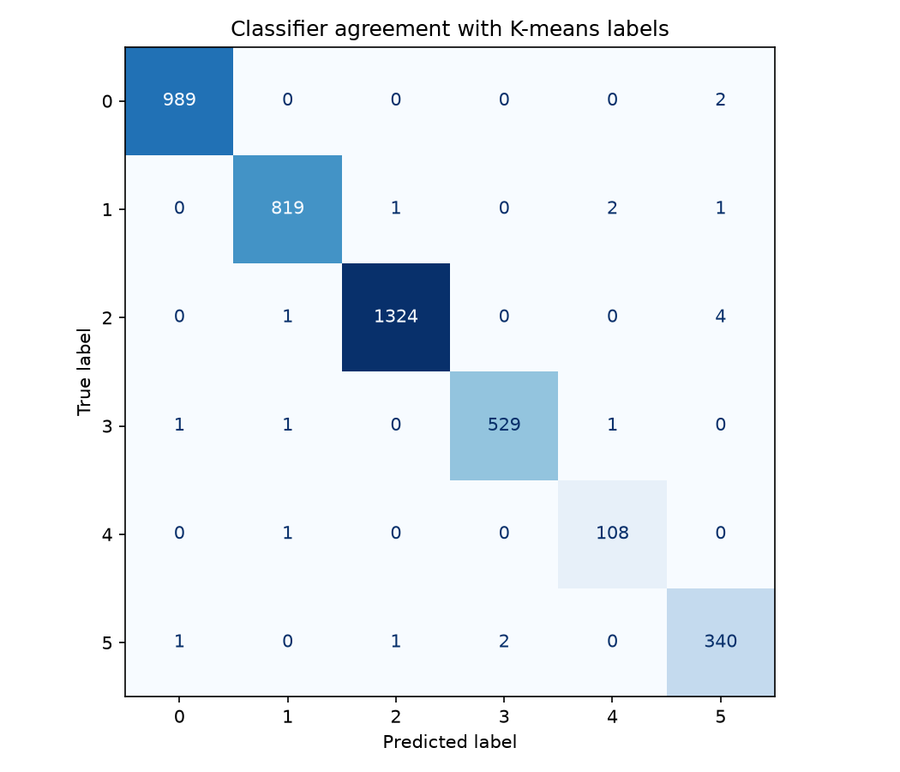

# California Housing — K-means Project Tutorial

Group 1990 California census block groups using **Latitude**, **Longitude** and **MedInc**, then train a supervised model to reproduce the six K-means groups. Housing prices are not inputs or targets.

## Results

- 20,640 observations; 16,512 training and 4,128 held-out test rows.
- No missing values in the three selected features. Five repeated feature triples are retained as distinct census blocks and kept together in all train/test and classifier CV splits.
- StandardScaler and KMeans (six clusters, 20 initializations, seed 42) fitted on training rows only.
- Five-fold stratified group CV: decision tree **99.29%**, logistic regression **99.52%**.
- Selected classifier: logistic regression, C=10.
- Held-out classifier agreement with K-means: **99.54%**, or **19 disagreements** across 4,128 rows.
- Training silhouette on a seeded 3,000-row sample: **0.411**.

This accuracy measures reproduction of K-means labels. It does not measure housing-price prediction or agreement with independently verified categories. Cluster IDs are arbitrary, not rankings. CV compares classifiers against one fixed K-means teacher fitted on the outer training set; it is not a full nested evaluation of clustering.

## Run

Python 3.13 was used for the saved artifacts. In Codespaces, run these commands from the repository root:

```bash
python -m pip install -r requirements.txt
python src/app.py
```

The script downloads the assignment CSV if needed, trains both model stages, evaluates, verifies saved-model predictions and regenerates reports. No API key or database is required. For a local installation, use a virtual environment before installing dependencies.

Open **src/explore.ipynb** for the fully executed walkthrough, tables, visualizations and explanations. Run all cells to reproduce the workflow. The notebook and command-line script share the same implementation.

Predict from saved models, passing latitude, longitude and median income in the original dataset units:

```bash
python src/app.py --predict 37.88 -122.23 8.3252
```

## Project files

- src/app.py — reusable data preparation, clustering, classifier comparison, evaluation, saving and prediction CLI.
- src/explore.ipynb — executed five-stage project notebook.
- models/kmeans_pipeline.joblib — fitted scaler and K-means.
- models/classifier_pipeline.joblib — selected classifier and its fitted scaler.
- reports/evaluation.json — data provenance, split sizes, model comparison, per-class metrics, confusion matrix, silhouette, versions and verification results.
- reports/cluster_summary.csv and cluster_centers.csv — group summaries and centroids in original units.
- reports/test_predictions.csv — held-out K-means and classifier labels with original row IDs.
- reports/figures/ — training map, train/test overlay and confusion matrix.
- requirements-project.txt — pinned versions used for this project; included by requirements.txt.

Raw and processed training data are ignored by Git and regenerated by the script. The source CSV checksum is recorded in evaluation.json. The original template's database helper is unused.

## Interpreting the groups

Northern clusters 0 and 3 differ in median income (2.88 versus 5.21 dataset units). Southern clusters 1 and 2 similarly separate higher and lower median income (5.13 versus 2.87). Cluster 4 has the highest median income (10.27) and only 414 training blocks. Cluster 5 has the lowest median income (2.54), with an average location between the northern and southern concentrations. Geographic overlap is expected because income is the third clustering feature.



Test points are crosses over the training map, using the same cluster colors. The similar pattern indicates consistent assignment to the learned partitions, not proof that six groups are objectively correct.



## Verification and limitations

The executed notebook has six completed code cells, no execution errors and three embedded plots. Checks confirm disjoint row IDs and feature triples across the outer split, six observed training clusters, training-only scaler fitting and identical predictions after reloading both saved pipelines. Prediction CLI was also exercised.

Six clusters are prescribed by the exercise, not proven optimal. Scaling gives location and income comparable influence; changing feature weights changes the groups. Euclidean distance on latitude/longitude approximates geography. A random group split is not a spatial holdout, so performance does not demonstrate generalization to an entirely new region. Census-block averages do not describe individuals, and 1990 data is not a current housing-market estimate.

## Source and assignment

Dataset: https://breathecode.herokuapp.com/asset/internal-link?id=439&path=housing.csv

Assignment: https://github.com/4GeeksAcademy/k-means-project-tutorial

Built from the 4GeeksAcademy machine-learning-python-template. This repository is prepared for review; submission and any personal authorship acknowledgement remain with the learner.
